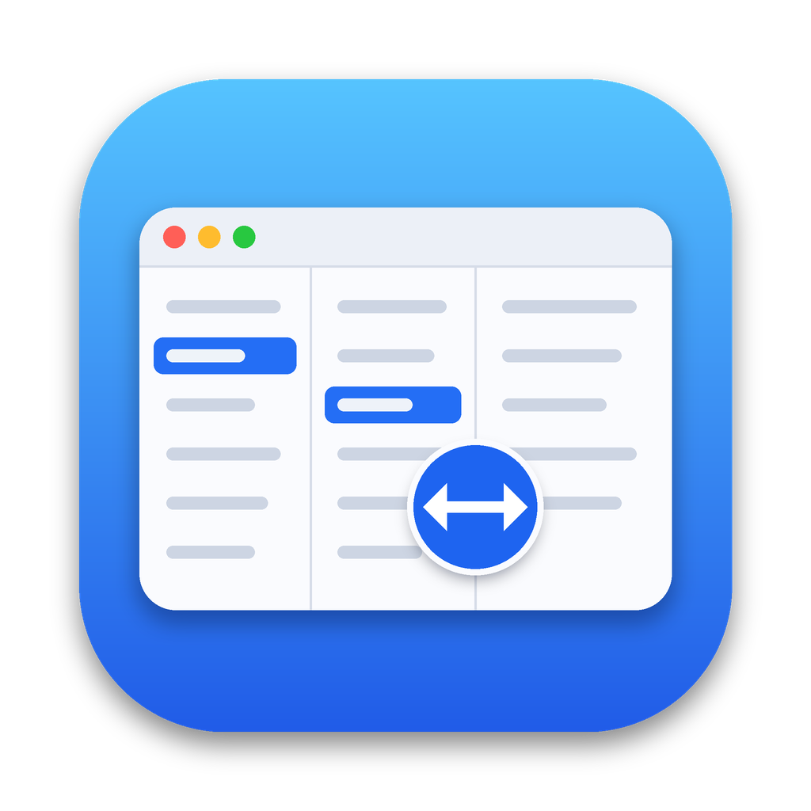

 <p align="center">
  
</p>

<h1 align="center">ColumnFit</h1>

<p align="center">
  A tiny menu bar app that automatically <b>right-sizes the newly opened column</b> in Finder's Column View — every time you select a folder, with the mouse <i>or</i> the arrow keys.
</p>

- macOS **13 Ventura and later** (Apple Silicon & Intel)
- Menu bar only, no Dock icon · no network access · no telemetry
- Languages: English (default), Deutsch, Türkçe, Français, Español
- MIT licensed

<p align="center">
  <a href="https://github.com/firatcam/ColumnFit/releases/latest"><b>Download ColumnFit</b></a> ·
  <a href="https://github.com/firatcam/ColumnFit/issues">Report a bug</a>
</p>

## Why?

Finder has no command for *Right Size This Column*. The only way is to double-click the column's resize handle (or ⌥-double-click for all columns). ColumnFit does that double-click for you, instantly and invisibly.

## Install

1. Download **ColumnFit-1.3.0.zip** from the [latest Releases](https://github.com/firatcam/ColumnFit/releases/latest) page and move `ColumnFit.app` to `/Applications`.
2. Open it. If macOS says it can't verify the developer (unsigned / ad-hoc builds), Control-click the app and choose **Open** once, if that option is available.
3. Grant **System Settings → Privacy & Security → Accessibility** permission to ColumnFit. This permission is required for Finder interaction.
4. Open a Finder window in Column View (⌘3) and select a folder.

Use the menu bar icon → **Launch at Login** to start it automatically.

## How it works

| Part | What it does |
| --- | --- |
| `SelectionWatcher` | While Finder is frontmost, polls a small Accessibility fingerprint (window title, selected rows) every 150 ms. A change means the selection changed — by keyboard, mouse or anything else. |
| `FinderInspector` | Finds the right-most column of the `AXBrowser` and the divider line at its right edge. |
| `ClickEngine` | Hides the pointer, detaches the physical mouse, jumps to the divider, double-clicks, jumps back, re-attaches the mouse, shows the pointer. Approximately 150–200 ms in total. |
| `Calibration` | A panel with a red marker drawn over the real divider, so you can choose any point along the line (bottom → top) and fine-tune the horizontal position. |

### Calibration

Menu bar icon → **Calibrate…**. Move the red point until its centre is on the draggable edge of the newest column, then press **Test**. Settings are saved.

### Diagnostics

Menu bar icon → **Diagnostics…** prints what ColumnFit can see (Accessibility permission, number of columns, divider geometry). Please attach it to bug reports.

## Build from source

Requirements: macOS 13+, Xcode 14+ (or the Command Line Tools), Swift 5.7+.

```bash
git clone https://github.com/firatcam/ColumnFit.git
cd ColumnFit
chmod +x scripts/build.sh
./scripts/build.sh
open build/ColumnFit.app
```

The build script creates `build/ColumnFit.app` and a versioned ZIP archive in `build/`.

The app icon is generated by `scripts/make-icon.py` (requires `pip install pillow`).

## Signed & notarized releases

Gatekeeper-friendly builds need a paid [Apple Developer Program](https://developer.apple.com/programs/) membership and a **Developer ID Application** certificate.

Locally:

```bash
CODESIGN_IDENTITY="Developer ID Application: Your Name (TEAMID)" \
APPLE_ID="you@example.com" \
APPLE_TEAM_ID="TEAMID" \
APPLE_APP_PASSWORD="app-specific-password" \
BUNDLE_ID="io.github.columnfit.ColumnFit" \
./scripts/build.sh
```

With GitHub Actions (`.github/workflows/build.yml`), add the required repository secrets and push a version tag such as `v1.3.0`. The workflow is configured to build and publish a release; signing and notarization depend on the required secrets being present.

| Secret | Content |
| --- | --- |
| `MACOS_CERT_P12` | Developer ID Application certificate exported as `.p12`, base64-encoded (`base64 -i cert.p12 \| pbcopy`) |
| `MACOS_CERT_PASSWORD` | Password of that `.p12` |
| `MACOS_SIGN_IDENTITY` | e.g. `Developer ID Application: Your Name (TEAMID)` |
| `APPLE_ID` | Apple ID email used for notarization |
| `APPLE_TEAM_ID` | 10-character team ID |
| `APPLE_APP_PASSWORD` | App-specific password from appleid.apple.com |

> ColumnFit needs to control Finder through Accessibility, so Mac App Store distribution may not be suitable. Developer ID signing and notarization are the recommended route for direct distribution.

## Notes & limitations

- Hiding the pointer from a background app uses the community-known `SetsCursorInBackground` connection property, resolved dynamically at runtime. If a future macOS removes it, ColumnFit keeps working — the pointer just stays visible for the approximately 0.2 seconds the click takes.
- The resize handle's exact position can differ slightly between macOS versions and display scaling; that is what the calibration panel is for.
- Finder must be the frontmost app; ColumnFit does nothing in the background.

## Contributing

Issues and pull requests are welcome. New translations live in `Sources/ColumnFit/Localization.swift`.

- [Report a bug](https://github.com/firatcam/ColumnFit/issues)
- [View source code](https://github.com/firatcam/ColumnFit)

## License

[MIT](LICENSE)
